# 🚌 Sistema de rastreo de buses UTA

[](https://www.odoo.com/)
[](https://www.python.org/)
[](https://www.postgresql.org/)
[](https://www.traccar.org/)
[](https://nodejs.org/)
[](https://expo.dev/)
[](https://azure.microsoft.com/)
[](LICENSE)

**Sistema de rastreo de buses UTA** es un módulo de Odoo 16 (`bus_tracking`), unido a un servidor Traccar y a una app de tableta para el chofer, que muestra en vivo dónde van los buses de la Universidad Técnica de Ambato. Lo usan tres públicos: el personal de transporte (panel de Odoo), los choferes (tableta) y los pasajeros (portal público sin login).

Se hizo como proyecto de la universidad: un sistema de transporte con indicadores de servicio, gestión de calidad documentada (ISO 25010, Pareto, Ishikawa, PDCA) y despliegue real en Azure.

> [!TIP]
> Demo pública: <https://buses.madebyjohan.xyz>. Para correrlo en local: `cp .env.example .env && docker compose up -d` y abrir <http://localhost:8069>.

---

## 📋 Descripción

### ¿Qué problema resuelve?

Los estudiantes esperan el bus sin saber si ya pasó, si viene tarde o si viene. La oficina de transporte no tiene cómo ver los buses en ruta, enterarse a tiempo de un SOS ni medir la puntualidad del servicio.

### ¿Qué hace?

1. El chofer entra a la tableta del bus (con su credencial QR o usuario y clave), elige bus y línea, e inicia el turno.
2. La tableta envía su posición GPS a Traccar por el protocolo OsmAnd, también en segundo plano y guardando los puntos cuando no hay señal.
3. Traccar reenvía cada posición a Odoo por webhook; un cron consulta la API de Traccar cada minuto como respaldo.
4. Odoo guarda la posición solo si el bus tiene un turno abierto, detecta llegadas a paradas, recorridos, desvíos, excesos de velocidad y señal perdida, y genera alertas.
5. El personal ve los buses en el mapa en vivo, atiende SOS e incidentes y recibe notificaciones push en el navegador.
6. Los pasajeros ven en el portal cuántas paradas le faltan al bus para llegar a la suya y pueden escribir a transporte.
7. Los reportes muestran 12 indicadores de transporte y de calidad del sistema, y se descargan en PDF.
8. A partir de las alertas, el sistema propone multas de demostración con su evidencia (mapa, tramo y gráfico de velocidad) y sus comprobaciones; la oficina las revisa en un kanban y el chofer puede presentar su descargo desde la tableta.

### ¿Para quién está pensado?

- **Oficina de transporte de la UTA**: administra buses, rutas, horarios y choferes, y vigila la operación.
- **Choferes**: usan solo la tableta; nunca entran al panel.
- **Estudiantes y personal**: consultan el portal público desde el celular, sin cuenta.

---

## 📸 Capturas

| | |
|---|---|
| 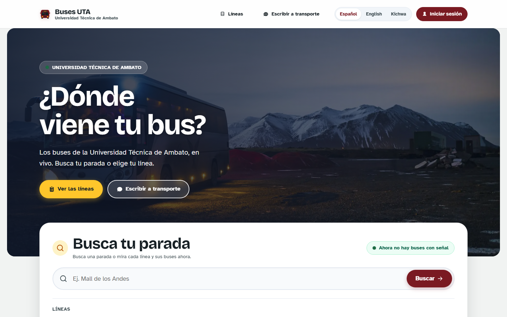<br><sub>Portada del portal de pasajeros: buscador de paradas y líneas.</sub> | 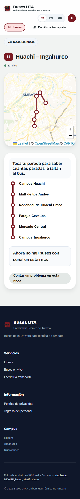<br><sub>Una línea en el celular: paradas y buses en vivo.</sub> |
| 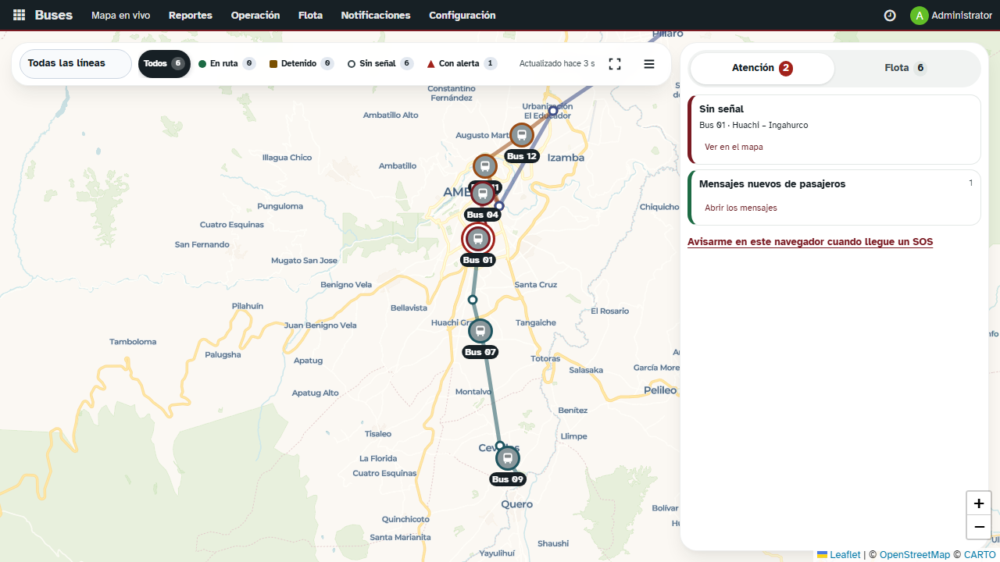<br><sub>Mapa en vivo del panel con la cola de Atención.</sub> | 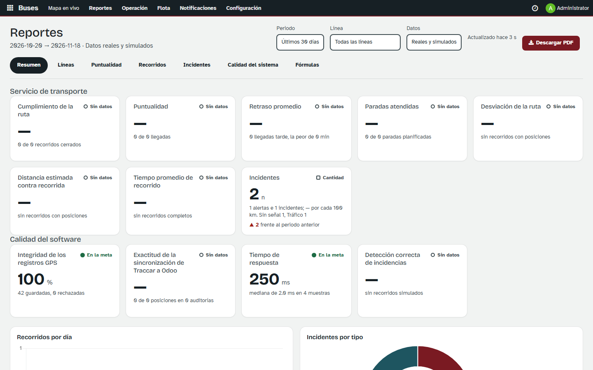<br><sub>Reportes: indicadores de transporte y de calidad, con descarga en PDF.</sub> |
| 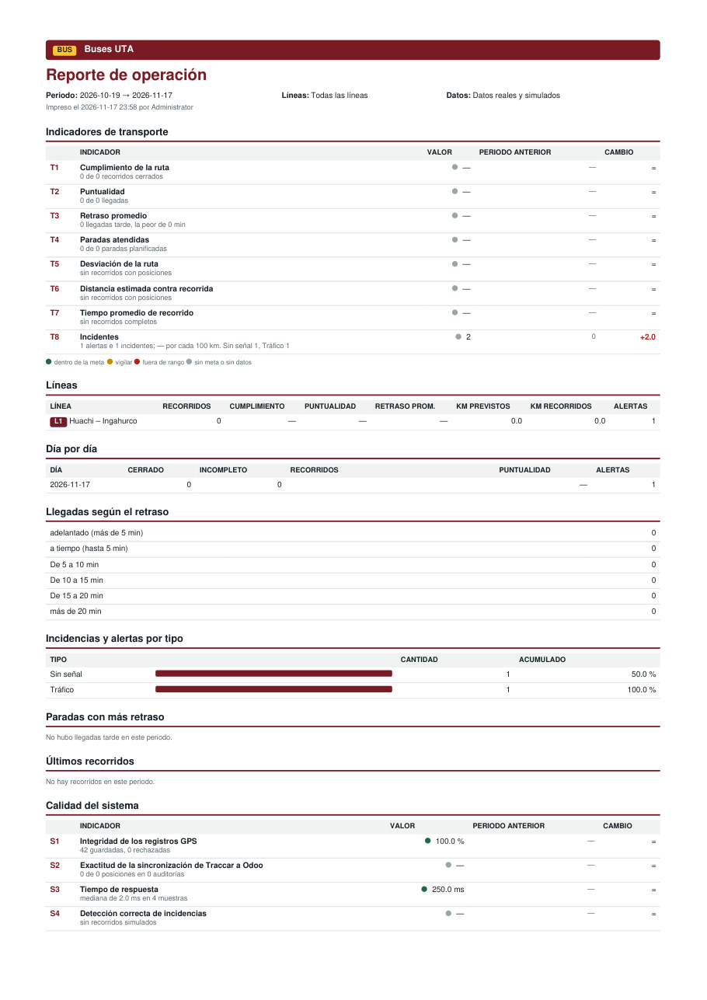<br><sub>Reporte de operación en PDF.</sub> | 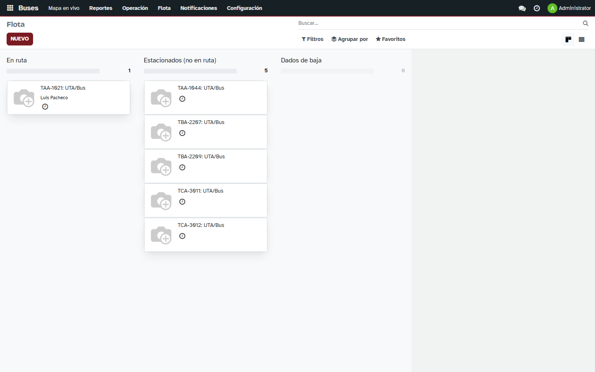<br><sub>Flota: en ruta, estacionados y dados de baja.</sub> |
| 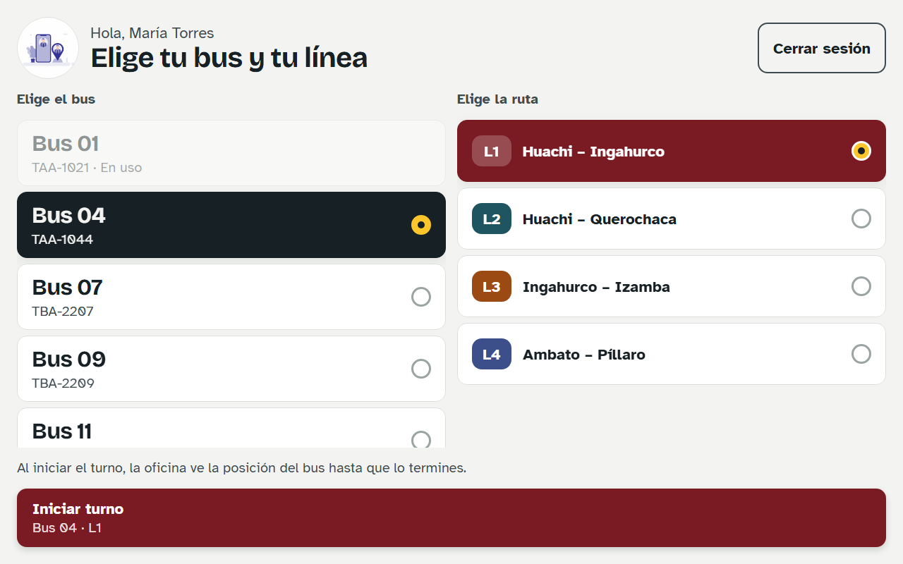<br><sub>Tableta: elegir bus y línea para iniciar el turno.</sub> | 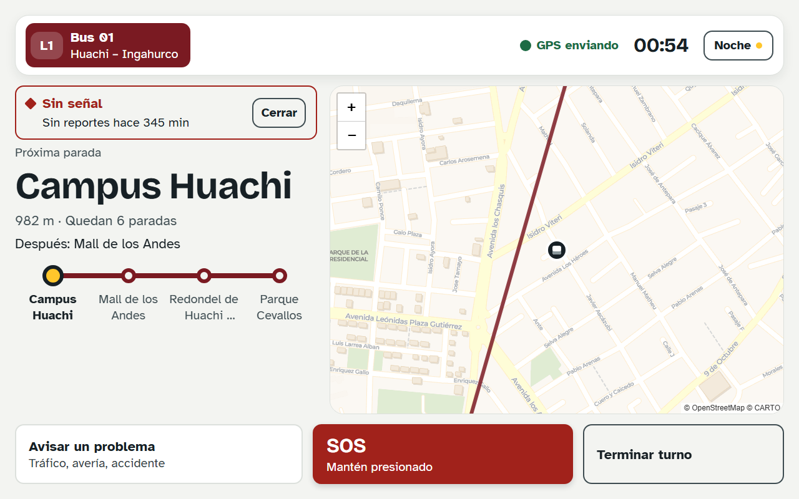<br><sub>Tableta en turno: próxima parada, alertas y SOS.</sub> |
| 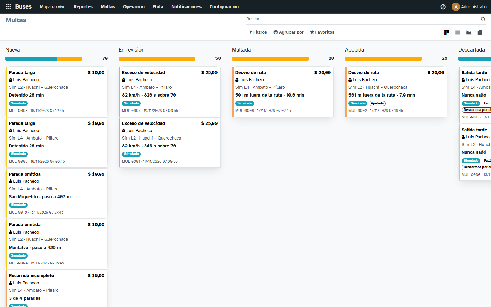<br><sub>Multas: kanban Nueva, En revisión, Multada, Apelada y Descartada.</sub> | 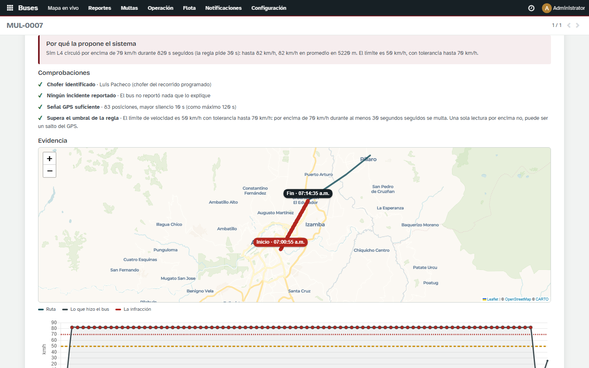<br><sub>Una multa por exceso de velocidad: porqué, comprobaciones y tramo en el mapa.</sub> |

Generadas con `scripts/dev_seed.py` en local (`qa/capturas_ui.py` y `qa/capturas_tablet.py`); no contienen datos reales.

---

## ✨ Características

- **Mapa en vivo**: buses con filtros por estado (en ruta, detenido, sin señal, con alerta) y una cola de Atención con SOS, incidentes, alertas y mensajes nuevos.
- **Turnos de chofer**: Odoo solo acepta posiciones de un bus con turno abierto; los turnos se cierran solos a las 14 horas.
- **App de tableta**: GPS en segundo plano, cola sin red, pantalla bloqueada en marcha, SOS con pulsación larga y modo día/noche.
- **Recordatorios de recorridos**: la tableta avisa 10 minutos antes de cada recorrido asignado al chofer y a la hora de salida, con notificaciones locales.
- **Alertas**: exceso de velocidad, sin señal, parada larga, desvío de ruta y parada no pasada, con umbrales en Ajustes.
- **Horarios y recorridos**: horarios por línea que generan los recorridos programados de cada día, con puntualidad por parada.
- **Reportes**: 12 indicadores (8 de transporte y 4 de calidad del sistema) con gráficos y reporte de operación en PDF comparado con el periodo anterior.
- **Flota**: integración con Odoo Fleet; tablero con columnas En ruta, Estacionados (no en ruta) y Dados de baja.
- **Notificaciones push**: los administradores reciben alertas e incidentes en el navegador; probado en Chrome y Edge de Windows.
- **Portal de pasajeros**: líneas, paradas y buses en vivo sin login; cuenta paradas, nunca promete minutos; nunca publica placa, chofer ni velocidad.
- **Mensajes de pasajeros**: formulario `/quejas` con protección contra abuso y tablero Nueva, En revisión y Resuelta.
- **Control de multas (demostración)**: seis reglas parametrizables (velocidad sobre 70 km/h por 30 s, desvío, parada larga, parada omitida, salida tardía y recorrido incompleto). El sistema propone cada multa con la evidencia congelada y las comprobaciones, y una persona decide en un kanban. El chofer responde una vez desde la tableta. Incluye estadísticas en el tablero y el PDF.
- **Tres idiomas**: español, inglés y kichwa (borrador) en el portal, el panel y la tableta.

---

## 🛠️ Tecnologías Utilizadas

- **Frontend del panel**: OWL (Odoo 16), Leaflet 1.9.4, Chart.js de Odoo, teselas CARTO Voyager (OpenStreetMap).
- **App de tableta**: Expo SDK 58, React Native 0.88, React 19, TypeScript, Expo Router, `expo-location`, `expo-task-manager`, `expo-notifications`.
- **Backend**: Odoo 16 (Python 3.9), módulo `bus_tracking` (depende de `mail`, `fleet` y `auth_totp`), `pywebpush` para Web Push, wkhtmltopdf para los PDF.
- **Rastreo**: Traccar 6.16.0 (protocolo OsmAnd, puerto 5055).
- **Base de datos**: PostgreSQL 15 en desarrollo; PostgreSQL 17 o Supabase en producción.
- **Pruebas y calidad**: pruebas de Odoo (`--test-enable`), Jest, ESLint, flake8, Playwright, axe, SonarQube, gitleaks.
- **Despliegue**: Docker Compose, Caddy 2 (HTTPS con Let's Encrypt), VM de Azure, EAS Build para el APK.

---

## 🏗️ Arquitectura

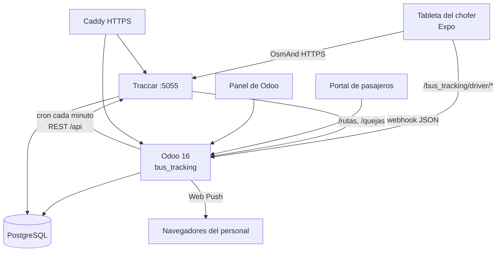

Odoo es la fuente de verdad: Traccar solo recibe el GPS y lo reenvía. Las posiciones duplicadas se descartan (único por bus y hora GPS), aunque el webhook y el cron traigan la misma a la vez.

---

## 📁 Estructura del Proyecto

```bash
sistema-rastreo-buses/
├── addons/
│   └── bus_tracking/          # Módulo Odoo 16
│       ├── controllers/       # Portal, API de la tableta, webhook, push, quejas
│       ├── models/            # Buses, rutas, turnos, recorridos, alertas, indicadores, reporte
│       ├── views/             # Vistas y menús del panel
│       ├── report/            # Reporte de operación en PDF
│       ├── static/            # OWL (mapa, tablero, push), CSS, Leaflet, service worker
│       ├── migrations/        # Migraciones por versión (16.0.1.1.0 a 16.0.1.10.0)
│       ├── i18n/              # es.po, qu.po y plantilla .pot
│       └── tests/             # Pruebas de Odoo
├── apps/
│   └── conductor-tablet/      # App del chofer (Expo, TypeScript)
├── config/                    # odoo.conf de desarrollo y producción
├── docker/odoo/               # Imagen de Odoo con pywebpush
├── docs/
│   ├── arquitectura/          # Roadmap, planes, requisitos, arquitectura y datos
│   ├── guias/                 # Chofer, operación, producción, personalización
│   ├── diseno/                # Diseño visual y privacidad
│   ├── calidad/               # Gestión de calidad, defectos, métricas, evidencias
│   ├── academico/             # Bitácora y guion de defensa
│   └── capturas/              # Imágenes de este README
├── proxy/                     # Caddyfile (HTTPS)
├── qa/                        # Suites de calidad, capturas y generadores de documentos
├── scripts/                   # Despliegue, respaldos, semillas de desarrollo
├── docker-compose.yml         # Entorno de desarrollo
├── docker-compose.prod.yml    # Producción
├── .env.example               # Variables de desarrollo
└── .env.prod.example          # Variables de producción
```

El índice de la documentación está en `docs/README.md`.

---

## 💻 Requisitos del Sistema

- Docker y Docker Compose.
- Node.js 20 para la app de tableta.
- Python 3 en el equipo para los scripts de `qa/` (Playwright para las capturas).
- Solo en producción: un servidor Linux con dos dominios (`DOMAIN` y `GPS_DOMAIN`), puertos 80 y 443 abiertos, y una base PostgreSQL (local o Supabase).
- Para la tableta: Android con GPS; el APK se compila con EAS Build.

---

## ⚙️ Instalación y Configuración

1. Clonar y crear el archivo de entorno:

   ```bash
   git clone https://github.com/kiramman-mp3/sistema-rastreo-buses.git
   cd sistema-rastreo-buses
   cp .env.example .env
   ```

   Variables de `.env`: `DB_PASSWORD`, `WEBHOOK_SECRET` (el mismo valor va en Ajustes de Odoo) y `ODOO_PORT` (8069 por defecto). Los secretos nunca se guardan en el repositorio.

2. Levantar los servicios:

   ```bash
   docker compose up -d
   ```

   Odoo queda en <http://localhost:8069> y Traccar en <http://localhost:8082>.

3. Crear la base e instalar el módulo con datos de ejemplo:

   ```bash
   MSYS_NO_PATHCONV=1 docker compose run --rm odoo odoo -d buses -i bus_tracking --load-language=es_EC --without-demo=all --stop-after-init --no-http
   docker compose exec -T odoo odoo shell -d buses --no-http --db_host db --db_user odoo --db_password odoo < scripts/dev_seed.py
   ```

   `scripts/dev_seed.py` crea 4 líneas de Ambato, 6 buses y los choferes `chofer1` (con turno abierto) y `chofer2`. Solo para desarrollo. En Git Bash de Windows, `MSYS_NO_PATHCONV=1` evita que las rutas se conviertan.

4. Configurar en `Configuración > Ajustes` de Odoo: URL de Traccar (`http://traccar:8082`), usuario o token, secreto del webhook y la dirección del GPS para las tabletas. Sin la dirección del GPS no se puede iniciar un turno.

5. App de tableta:

   ```bash
   cd apps/conductor-tablet
   npm install
   EXPO_PUBLIC_ODOO_URL=http://<ip-del-pc>:8069 npx expo start
   ```

---

## 🚀 Uso y Ejecución

### Desarrollo

Crea las rutas con sus paradas, los buses (botón **Register GPS in Traccar**) y los choferes (`Flota > Nuevo chofer`, con credencial QR opcional). Para probar sin tableta, activa *Aceptar posiciones sin turno* en Ajustes y envía una posición:

```bash
curl "http://localhost:5055/?id=<identificador>&lat=-1.24&lon=-78.62&speed=10"
```

### Producción local

`docker-compose.yml` es solo para desarrollo. Para un servidor se usa `docker-compose.prod.yml` (ver Despliegue).

| Comando | Qué hace |
|---|---|
| `docker compose up -d` | Levanta Postgres, Odoo y Traccar de desarrollo |
| `MSYS_NO_PATHCONV=1 docker compose run --rm odoo odoo -d buses_test -i bus_tracking --test-enable --test-tags /bus_tracking --stop-after-init --without-demo=all --no-http` | Corre las pruebas de Odoo |
| `python -m flake8 addons/bus_tracking` | Linter de Python |
| `python -X utf8 qa/traducciones.py` | Comprueba que `es.po` esté completo |
| `cd apps/conductor-tablet && npm test` | Pruebas de Jest de la tableta |
| `npm run lint` / `npm run typecheck` | ESLint y TypeScript de la tableta |
| `npm run eas:android` | Compila el APK de producción en EAS |
| `sh qa/ejecutar_todo.sh` | Pruebas en vivo y auditoría de calidad |
| `python -X utf8 qa/generar_docs.py` | Regenera los documentos de `docs/calidad/` |
| `./scripts/backup.sh` / `./scripts/restore.sh <archivo>` | Respaldo y restauración de las bases |

Después de las pruebas de Odoo, borra la base de prueba (`docker compose exec -T db dropdb -U odoo buses_test`): con dos bases, las páginas públicas fallan.

---

## ☁️ Despliegue

La demo corre en una VM de Azure con `docker-compose.prod.yml`, Caddy como proxy HTTPS y respaldos a una cuenta de almacenamiento privada. La guía completa está en `docs/guias/PRODUCCION.md`.

```bash
cp .env.prod.example .env.prod      # editar DOMAIN, GPS_DOMAIN, ACME_EMAIL y los secretos
sudo ./scripts/init-prod.sh
```

| Variable | Uso |
|---|---|
| `DOMAIN` / `GPS_DOMAIN` | Dominio del panel y dominio al que envían las tabletas |
| `ACME_EMAIL` | Correo para los certificados de Let's Encrypt |
| `DB_HOST`, `DB_PORT`, `DB_USER`, `DB_PASSWORD` | Base de Odoo (local o Supabase) |
| `TRACCAR_DATABASE_URL`, `TRACCAR_DB_USER`, `TRACCAR_DB_PASSWORD` | Base de Traccar |
| `WEBHOOK_SECRET` | Secreto del reenvío Traccar → Odoo |
| `ODOO_DB`, `ODOO_LANG` | Base y lenguaje de Odoo |
| `POSTGRES_IMAGE`, `ODOO_IMAGE`, `TRACCAR_IMAGE` | Versiones de las imágenes |
| `BACKUP_KEEP_DAYS` | Días que se guardan los respaldos |

La tableta toma la dirección de Odoo de `EXPO_PUBLIC_ODOO_URL`, definida como variable de entorno en EAS.

---

## 🔌 API y reglas del sistema

### API de la tableta

Todas por `POST`, con `Authorization: Bearer <token>` salvo el login.

| Endpoint | Uso |
|---|---|
| `/bus_tracking/driver/login` | Login con usuario y clave; devuelve el token |
| `/bus_tracking/driver/login_badge` | Login con la credencial QR |
| `/bus_tracking/driver/logout` | Cierra la sesión de la tableta |
| `/bus_tracking/driver/me` | Chofer, buses, líneas, turno abierto y próximos recorridos asignados |
| `/bus_tracking/driver/shift/start` | Inicia el turno; entrega el identificador OsmAnd y la dirección del GPS |
| `/bus_tracking/driver/shift/end` | Termina el turno |
| `/bus_tracking/driver/state` | Paradas, próxima parada, alertas y estado del SOS |
| `/bus_tracking/driver/route` | Trazado de la línea |
| `/bus_tracking/driver/incident` | Aviso o SOS |
| `/bus_tracking/driver/client_error` | Fallas de la app para la oficina |
| `/bus_tracking/driver/fines` | Multas confirmadas del chofer, con el porqué y las comprobaciones en el idioma de la app |
| `/bus_tracking/driver/fines/appeal` | Descargo del chofer sobre una multa: una sola vez y dentro del plazo |

### Endpoints públicos

| Endpoint | Uso |
|---|---|
| `/`, `/inicio`, `/transporte` | Portada del portal |
| `/rutas`, `/rutas/<código>`, `/rutas/<código>/buses.json` | Líneas, una línea y sus buses en vivo |
| `/quejas` | Formulario de mensajes de pasajeros |
| `/privacidad` | Aviso de privacidad |
| `/bus_tracking/traccar/webhook` | Reenvío de posiciones desde Traccar (cabecera `X-Webhook-Secret`) |
| `/bus_tracking/health` | Monitoreo: 200 `ok` o 503 `stale` si ningún bus reporta |

### Modelos principales

| Modelo | Uso |
|---|---|
| `bus.vehicle` | Bus enlazado a su dispositivo de Traccar y a su vehículo de Fleet |
| `bus.route` / `bus.route.stop` | Líneas con paradas ordenadas y radio de llegada |
| `bus.route.schedule` / `bus.trip` | Horarios y recorridos programados, con chofer asignado |
| `bus.shift` | Turnos de los choferes |
| `bus.position` / `bus.stop.arrival` | Posiciones y llegadas a paradas |
| `bus.alert` / `bus.incident` | Alertas automáticas y avisos o SOS del chofer |
| `bus.complaint` | Mensajes de pasajeros |
| `bus.driver.token` | Sesiones de tableta y credenciales QR (solo se guarda la huella) |
| `bus.push.subscription` | Navegadores suscritos a las notificaciones push |
| `bus.report.wizard` | Reporte de operación en PDF |
| `bus.fine.type` / `bus.fine` | Reglas de multa y multas propuestas, con evidencia, comprobaciones, decisión y descargo |

### Reglas de negocio

| Regla | Valor |
|---|---|
| Posiciones aceptadas | Solo de buses con turno abierto (salvo *Aceptar posiciones sin turno*) |
| Cierre automático del turno | 14 horas |
| Desvío de ruta | Más de 150 m durante 3 minutos |
| Recordatorio al chofer | 10 minutos antes del recorrido y a la hora de salida |
| Multa por velocidad | Más de 70 km/h durante 30 s seguidos (el límite es 50 km/h; entre 50 y 70 solo hay alerta) |
| Otras multas | Desvío de más de 300 m por 3 minutos, parada de más de 20 minutos lejos de las paradas, parada omitida, salida con más de 10 minutos de retraso, recorrido incompleto |
| Comprobaciones de una multa | Chofer identificado, sin incidentes reportados, señal GPS suficiente; si una falla, nace descartada por el sistema |
| Descargo del chofer | Uno por multa, dentro de 3 días desde que se confirma |
| Portal | Cuenta paradas, no minutos; no publica placa, chofer ni velocidad |
| Grupos | User (lectura y mapa), Manager (todo), Driver (solo la API de la tableta, usuarios de portal) |

### Migraciones

Las migraciones están en `addons/bus_tracking/migrations/<versión>/`. La versión actual del módulo es `16.0.1.10.0`, que agrega las multas y marca como revisadas por el detector las alertas que ya existían. La `16.0.1.9.0` retira Grafana (vistas `kpi_*`, tabla de conteos diarios y parámetros) y marca qué vehículos de la flota están en ruta. Se aplican con `-u bus_tracking`.

### Calidad

Política, casos de prueba, resultados, registro de defectos, Pareto, Ishikawa y cumplimiento ISO están en `docs/calidad/` (índice en `docs/calidad/README.md`). Última corrida (20-nov): 624 pruebas de Odoo, 622 en verde; las 2 que fallan son de la migración de Grafana y dependen de la base de desarrollo local (DEF-084). 197 de Jest en verde. El CI (`.github/workflows/ci.yml`) corre la tableta, gitleaks, el linter y traducciones del módulo y la suite de Odoo contra Postgres.

### Lo que queda por confirmar

La segunda auditoría (17-nov-2026) concluyó que el sistema aún **no está listo para producción general**: falta la fase 46, una jornada real con tabletas. El detalle está en `docs/arquitectura/PLAN-AUDITORIA-2.md`.

---

## 🗺️ Roadmap de Funcionalidades

- [x] Odoo 16 + Traccar con Docker, mapa en vivo y alertas
- [x] Celulares como GPS (OsmAnd) y portal de pasajeros
- [x] App de tableta del chofer con GPS en segundo plano y cola sin red
- [x] Rediseño del portal, el panel y la cabina
- [x] Horarios, recorridos, simulador e indicadores
- [x] Integración con Odoo Fleet
- [x] Correcciones de la primera y la segunda auditoría (fases 38 a 45)
- [x] Reportes propios de Odoo con PDF (Grafana retirado)
- [x] Flota en tablero En ruta / Estacionados / Dados de baja
- [x] Notificaciones push del administrador en Windows
- [x] Recordatorios de recorridos en la tableta
- [x] Control de multas de demostración con evidencia, kanban y descargo del chofer
- [ ] Multas reales según el reglamento interno de la empresa
- [ ] Fase 46: jornada real con tabletas, Supabase y VM Linux
- [ ] Revisión del kichwa por una persona hablante
- [ ] Pruebas de usabilidad con personas
- [ ] Dominio institucional, correo real y suscripción de Azure definitiva

El estado detallado está en `docs/arquitectura/ROADMAP.md`.

---

## 👥 Contribuidores

| Nombre | Commits |
|---|---|
| JoseM151 | 430 |
| kiramman-mp3 | 242 |
| Johan Rodríguez | 218 |

---

## 📚 Fuentes y referencias

<details>
<summary>Ver referencias</summary>

- Documentación de Odoo 16: <https://www.odoo.com/documentation/16.0/>
- Traccar, protocolo OsmAnd y reenvío de eventos: <https://www.traccar.org/documentation/>
- Expo SDK 58: <https://docs.expo.dev/versions/v58.0.0/>
- Leaflet: <https://leafletjs.com/>
- Teselas CARTO Voyager y datos de OpenStreetMap: <https://carto.com/basemaps/>, <https://www.openstreetmap.org/copyright>
- Web Push (RFC 8030, RFC 8291) y VAPID (RFC 8292)
- ISO/IEC 25010 (calidad del producto de software)

</details>

---

## 📄 Licencia

Este proyecto se distribuye bajo la licencia LGPL-3.0; ver [LICENSE](LICENSE).

---

## ✍️ Autor

Johan Rodríguez
