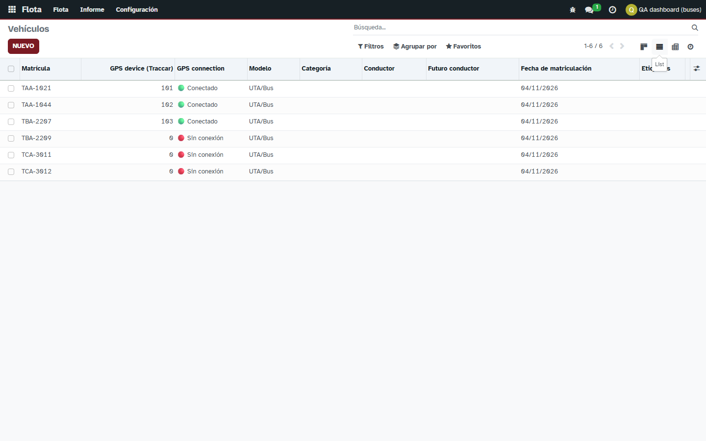
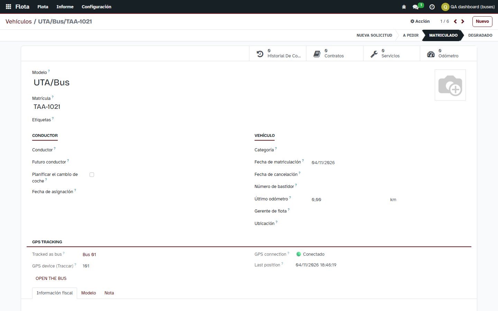
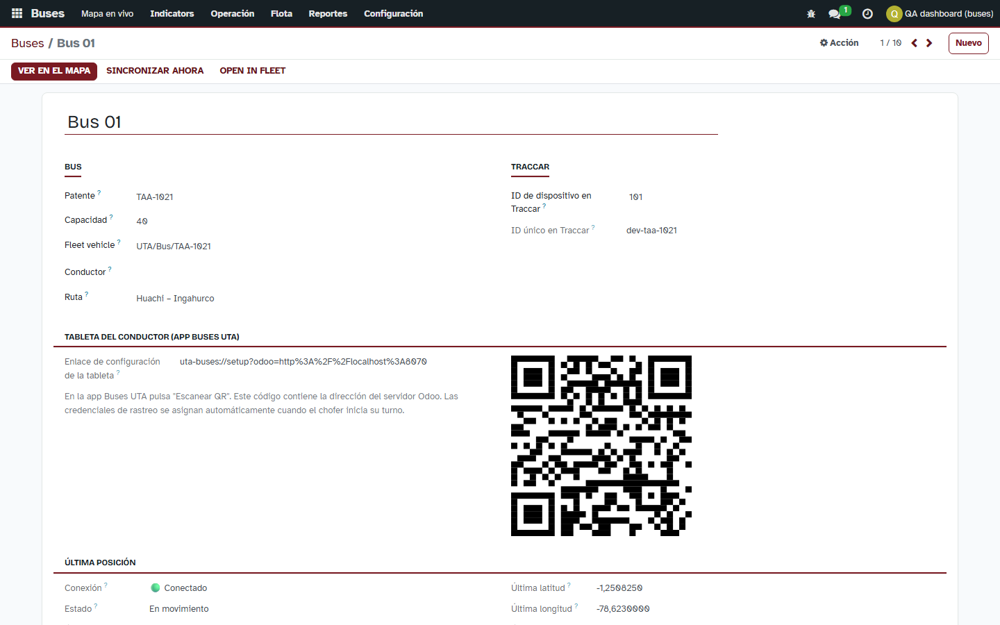

# Módulo Fleet de Odoo y los buses

Evidencia de la Actividad 2 del proyecto final: «uso del módulo Fleet de Odoo para registrar los vehículos de la flota». Desde la versión 16.0.1.6.0, `bus_tracking` **depende de `fleet`** y cada bus
tiene su vehículo en Fleet.

## 1. La decisión

| Opción | Qué implica | Veredicto |
|---|---|---|
| Reemplazar `bus.vehicle` por `fleet.vehicle` | Perder lo propio del rastreo (dispositivo Traccar, última posición, alertas, turnos, recorridos) o llenar Fleet de campos ajenos; romper la app de la tableta y las reglas | Descartada |
| Ignorar Fleet | No cumple la actividad 2 | Descartada |
| **Mantener `bus.vehicle` y enlazarlo con `fleet.vehicle`** | Cada sistema guarda lo suyo; lo que comparten se mantiene igual en los dos | **Elegida** |

`bus.vehicle` sigue siendo el **bus que se rastrea**: dispositivo Traccar, última posición, conexión, alertas, turnos, horarios y recorridos, y es lo que usan la app de la tableta, el mapa y el portal público.
`fleet.vehicle` es el **vehículo de la empresa**: placa, conductor, asientos, contratos, servicios, odómetro y costos, con las herramientas de Fleet.

## 2. Qué comparten

| Dato | `bus.vehicle` | `fleet.vehicle` | Sentido |
|---|---|---|---|
| Placa | `plate` | `license_plate` | ambos |
| Conductor | `driver_id` | `driver_id` | ambos |
| Capacidad | `capacity` | `seats` | ambos |
| Activo | `active` | `active` | ambos (archivar uno archiva el otro) |
| Marca y modelo | — | «UTA» / «Bus» (datos del módulo) | solo Fleet |
| Dispositivo GPS, conexión, última posición | propios | se muestran en el vehículo (campos relacionados) | solo lectura en Fleet |

Cambiar el dato en cualquiera de los dos lados lo copia al otro **una sola vez** (un indicador en el contexto evita que el cambio rebote). Lo que solo existe en un lado no se toca.

## 3. Reglas

- **Crear un bus crea su vehículo** en Fleet. Si ya existe un vehículo de Fleet con esa placa que ningún bus usa, se enlaza en lugar de duplicarlo.
- **Un vehículo de Fleet pertenece a un solo bus** (restricción en la base de datos).
- **Los buses simulados** (los del simulador de recorridos) **no llegan a Fleet**: no son vehículos de la empresa.
- **Borrar el vehículo en Fleet no borra el bus** (el enlace queda vacío; Fleet mismo impide borrar vehículos con historial de conductor).
- **Permisos**: el gestor de buses recibe el grupo *Administrator* de Fleet (el *Officer* de Fleet solo ve el vehículo que conduce) y ve el menú **Buses › Fleet › Fleet vehicles**. Los demás usuarios de buses no lo ven.
- **Pantallas y unificación**: Toda la gestión de la flota se centralizó en `fleet.vehicle` para evitar duplicidad:
  - El submenú redundante **Buses** bajo Flota se oculta (`active="False"`), dejando **Vehículos de flota** como único punto de acceso.
  - El formulario del vehículo incorpora en el encabezado los botones de acción (`View on map`, `Register GPS in Traccar`, `Sync now`, `Start/Stop demo report`), el botón de estadística **Live Map** y la pestaña **GPS tracking** con el código QR para la tableta del chofer.
  - Se eliminó el botón redundante **Bus Details**.
  - Se ocultó el bloque estático **Driver** (Conductor e historial) del formulario vehicular: en el sistema de transporte público de la UTA los buses no pertenecen a un conductor fijo, sino que los choferes toman cualquier unidad de forma dinámica mediante **Turnos** (`bus.shift`).

## 4. Instalación y migración

La actualización a 16.0.1.6.0 instala `fleet` sola y ejecuta `migrations/16.0.1.6.0/post-migrate.py`, que enlaza los buses ya registrados (`bus.vehicle._link_fleet()`): usa el vehículo que ya tenga la placa o crea uno, y se puede
repetir sin duplicar. Probado en la base de desarrollo: 6 buses enlazados y los 4 simulados sin vehículo.

En producción: **respaldo antes de actualizar** (`scripts/backup.sh`) y probar primero sobre una copia (`docs/guias/PRODUCCION.md`).

## 5. Pruebas (`tests/test_fleet.py`, 22)

Crear un bus crea su vehículo (marca UTA, modelo Bus, placa, conductor y asientos); dos buses, dos vehículos; sin placa también; el simulado no llega; un vehículo no puede ser de dos buses; editar placa,
conductor, capacidad o activo en un lado actualiza el otro (en los dos sentidos); lo que no se comparte no cambia; no hay rebote; un vehículo de Fleet que no es bus no afecta a ningún bus;
borrar el vehículo conserva el bus; la migración enlaza sin duplicar y reutiliza el vehículo que ya tenía la placa; el botón abre el vehículo; el vehículo muestra el dispositivo GPS; el menú es de gestores.

## 6. Evidencia

Buses en Fleet con su dispositivo GPS (datos de desarrollo):

