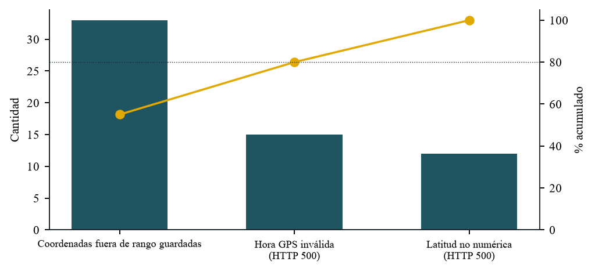
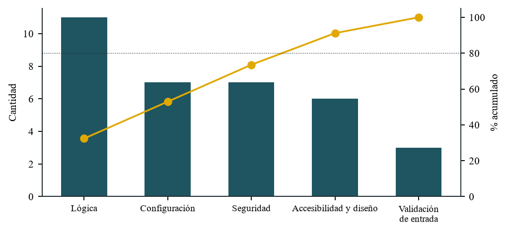
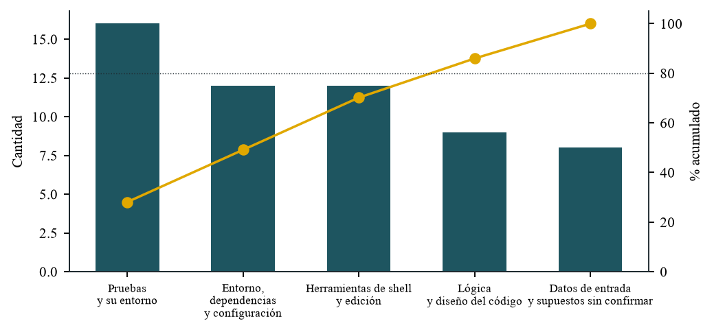

# Diagramas de Pareto

El principio de Pareto dice que pocas causas producen la mayor parte de los efectos. Aquí se aplica a tres series de datos reales del proyecto. Las figuras están en `docs/calidad/figuras/` y las tablas se generan con `qa/generar_docs.py`.

## 1. Fallos de la evaluación del 28-oct-2026

Fallos de la suite en vivo (3) y de la auditoría aleatoria (57), por causa. Las tres causas están en la validación de la posición que llega por el webhook.

| Causa | Fallos | % | % acumulado |
|---|---|---|---|
| Coordenadas fuera de rango guardadas (DEF-008) | 33 | 55,0 % | 55,0 % |
| Hora GPS inválida, HTTP 500 (DEF-010) | 15 | 25,0 % | 80,0 % |
| Latitud no numérica, HTTP 500 (DEF-009) | 12 | 20,0 % | 100,0 % |

**Lectura:** las coordenadas fuera de rango son por sí solas más de la mitad de los fallos, y con la hora inválida llegan a cerca del 80 %. Un solo cambio (validar la posición en `_apply_position`) cierra las tres.

## 2. Defectos registrados por categoría

| Categoría | Defectos | % | % acumulado |
|---|---|---|---|
| Lógica | 11 | 32,4 % | 32,4 % |
| Configuración | 7 | 20,6 % | 52,9 % |
| Seguridad | 7 | 20,6 % | 73,5 % |
| Accesibilidad y diseño | 6 | 17,6 % | 91,2 % |
| Validación de entrada | 3 | 8,8 % | 100,0 % |

**Lectura:** con la auditoría del 2-nov la lógica y la seguridad pasan a encabezar: los defectos ya no están en la entrada de datos sino en reglas que se cumplían sólo en un lado (la vista y no el método, la tableta y no el servidor). Queda abierto uno de seguridad (DEF-013).

## 3. Problemas encontrados durante la construcción (53)

Cada viñeta de las secciones "Problemas encontrados" de la bitácora cuenta como un problema (los de la evaluación de calidad incluidos). Se clasificó cada uno en una de cinco categorías; la lista completa está al final.

| Categoría | Problemas | % | % acumulado |
|---|---|---|---|
| Pruebas y su entorno | 16 | 30,2 % | 30,2 % |
| Herramientas de shell y edición | 12 | 22,6 % | 52,8 % |
| Entorno, dependencias y configuración | 10 | 18,9 % | 71,7 % |
| Datos de entrada y supuestos sin confirmar | 8 | 15,1 % | 86,8 % |
| Lógica y diseño del código | 7 | 13,2 % | 100,0 % |

**Lectura:** más de la mitad de los problemas no estuvo en el producto sino en las **pruebas y su entorno** y en las **herramientas de shell**: tests mal escritos, bases sucias, rutas que Git Bash convierte, comillas. Con las tres primeras categorías se llega a cerca del 72 %. Acciones que salen de aquí: una base de pruebas nueva en cada corrida (ya está en `qa/ejecutar_todo.sh`), scripts en archivos y no en la línea de comandos, y versiones fijas de las dependencias.

### Clasificación completa

Categorías: Pruebas y su entorno; Herramientas de shell y edición; Entorno, dependencias y configuración; Datos de entrada y supuestos sin confirmar; Lógica y diseño del código.

| N.º | Sesión | Problema | Categoría |
|---|---|---|---|
| 1 | 1.ª (26-oct) | Puerto 8069 ocupado por otro Odoo de la máquina | Entorno, dependencias y configuración |
| 2 | 1.ª (26-oct) | Traccar 6 reenvía con otra clave y el webhook respondía 405 | Entorno, dependencias y configuración |
| 3 | 1.ª (26-oct) | "docker compose exec odoo shell" no recibe los argumentos de la base de datos | Herramientas de shell y edición |
| 4 | 2.ª (26-oct) | Unsplash bloquea la descarga de fotos desde la línea de comandos | Entorno, dependencias y configuración |
| 5 | 2.ª (26-oct) | Una foto candidata era de pago (Unsplash+) y se descartó | Datos de entrada y supuestos sin confirmar |
| 6 | 2.ª (26-oct) | La herramienta de pruebas no cambia el ancho real de la pantalla | Herramientas de shell y edición |
| 7 | 2.ª (26-oct) | La ruta animada del hero queda bajo el pliegue en pantallas bajas | Lógica y diseño del código |
| 8 | 3.ª (26-oct) | Git Bash convierte /bus_tracking en una ruta de Windows y no corre ningún test | Herramientas de shell y edición |
| 9 | 3.ª (26-oct) | El script que generó es.po perdió las barras invertidas al pasar por la shell | Herramientas de shell y edición |
| 10 | 3.ª (26-oct) | Los tests HttpCase dependen de la contraseña admin de una base nueva | Pruebas y su entorno |
| 11 | 4.ª (26-oct) | Respaldo del filestore vacío: faltaba data_dir en la configuración de producción | Entorno, dependencias y configuración |
| 12 | 4.ª (26-oct) | Docker creó un directorio donde iba un archivo de configuración | Entorno, dependencias y configuración |
| 13 | 4.ª (26-oct) | Un comando de prueba fue bloqueado por la verificación de seguridad | Herramientas de shell y edición |
| 14 | 4.ª (26-oct) | El log de Odoo imprimía el secreto del webhook porque iba en la URL | Lógica y diseño del código |
| 15 | 4.ª (26-oct) | La redirección a HTTPS apuntaba al puerto de la prueba | Entorno, dependencias y configuración |
| 16 | 4.ª (26-oct) | El script de traducción no manejaba textos de ayuda en varias líneas | Herramientas de shell y edición |
| 17 | 5.ª (26-oct) | Un test del reporte falló por un error del propio test (mapped elimina duplicados) | Pruebas y su entorno |
| 18 | 5.ª (26-oct) | Los tests comparaban horas con microsegundos contra horas exactas | Pruebas y su entorno |
| 19 | 8.ª (26-oct) | Encabezado del portal desbordado en pantallas de 390 px | Lógica y diseño del código |
| 20 | 8.ª (26-oct) | El navegador mostraba un CSS viejo de la caché | Entorno, dependencias y configuración |
| 21 | 8.ª (26-oct) | Dos tests mal escritos (cookie de idioma y posición repetida) | Pruebas y su entorno |
| 22 | 8.ª (26-oct) | Datos de ejemplo en la base de desarrollo rompieron los tests | Pruebas y su entorno |
| 23 | 8.ª (26-oct) | Los tests comparan textos en inglés y fallan si se carga el español | Pruebas y su entorno |
| 24 | 9.ª (26-oct) | Cuatro tests mal escritos (redirección absoluta, caso sin error) | Pruebas y su entorno |
| 25 | 9.ª (26-oct) | Un comando con demasiadas comillas falló dos veces sin ejecutarse | Herramientas de shell y edición |
| 26 | 9.ª (26-oct) | A una plantilla XML le faltaba el cierre </odoo> tras fusionar partes | Herramientas de shell y edición |
| 27 | 9.ª (26-oct) | El folio de la prueba en Chrome fue Q-00075 porque los tests consumieron la secuencia | Pruebas y su entorno |
| 28 | 9.ª (26-oct) | Los tests deben correr en una base limpia y sin español | Pruebas y su entorno |
| 29 | 10.ª (26-oct) | La foto de portada no era de Ambato (paradero con letrero en portugués) | Datos de entrada y supuestos sin confirmar |
| 30 | 10.ª (26-oct) | El nombre "Buses UTA" y el aviso de privacidad son provisionales | Datos de entrada y supuestos sin confirmar |
| 31 | 10.ª (26-oct) | El límite de 50 km/h es un supuesto sin contrastar con la normativa | Datos de entrada y supuestos sin confirmar |
| 32 | 10.ª (26-oct) | Un test falló porque el orden de los atributos del enlace no era el supuesto | Pruebas y su entorno |
| 33 | 10.ª (26-oct) | Los scripts largos fallaban en la shell y se escribieron como archivos | Herramientas de shell y edición |
| 34 | 11.ª (26-oct) | pip install pywebpush actualizó cryptography y Odoo dejó de arrancar | Entorno, dependencias y configuración |
| 35 | 11.ª (26-oct) | Los tests contaban el correo de invitación de Odoo como propio | Pruebas y su entorno |
| 36 | 11.ª (26-oct) | El asistente de respuesta mostraba   como texto (Markup escapado) | Lógica y diseño del código |
| 37 | 11.ª (26-oct) | mail.send() borra el correo enviado y los tests no podían leerlo | Pruebas y su entorno |
| 38 | 11.ª (26-oct) | Un script de mutaciones usó sintaxis de Git Bash dentro de Windows | Herramientas de shell y edición |
| 39 | 11.ª (26-oct) | Con mail instalado aparece el menú "Conversaciones" que no es del sistema | Entorno, dependencias y configuración |
| 40 | 12.ª (26-oct) | El texto extraído del PDF oficial salía mezclado entre celdas | Datos de entrada y supuestos sin confirmar |
| 41 | 12.ª (26-oct) | El documento oficial traía erratas, solapes y recorridos sin horas | Datos de entrada y supuestos sin confirmar |
| 42 | 12.ª (26-oct) | "any" no existe en los dominios de Odoo 16 | Lógica y diseño del código |
| 43 | 12.ª (26-oct) | Un servicio archivado dejaba al bus sin línea | Lógica y diseño del código |
| 44 | 12.ª (26-oct) | El mapa parecía mal ajustado por la rueda del ratón de la herramienta de prueba | Pruebas y su entorno |
| 45 | 12.ª (26-oct) | Git Bash volvió a convertir una ruta al pasarla en una variable | Herramientas de shell y edición |
| 46 | 13.ª (27-oct) | Overpass rechazó la descarga de toda la zona (502 y 406) | Entorno, dependencias y configuración |
| 47 | 13.ª (27-oct) | Calles homónimas de otras zonas hicieron un trazado de 133 km | Datos de entrada y supuestos sin confirmar |
| 48 | 13.ª (27-oct) | Acentos rotos y puntos sueltos del PDF partían mal los nombres | Datos de entrada y supuestos sin confirmar |
| 49 | 13.ª (27-oct) | Los heredocs de Git Bash fallan con ciertas comillas | Herramientas de shell y edición |
| 50 | 14.ª (27-oct) | Un bus sin ruta rompía el cálculo de desvío (lo halló un test) | Lógica y diseño del código |
| 51 | Evaluación (28-oct) | Dos corridas de la suite en vivo se pisaron y falsearon un resultado | Pruebas y su entorno |
| 52 | Evaluación (28-oct) | Los límites de uso viven en memoria y hay que reiniciar el servidor antes de medir | Pruebas y su entorno |
| 53 | Evaluación (28-oct) | Dos pruebas compartían buses y daban conteos falsos | Pruebas y su entorno |
