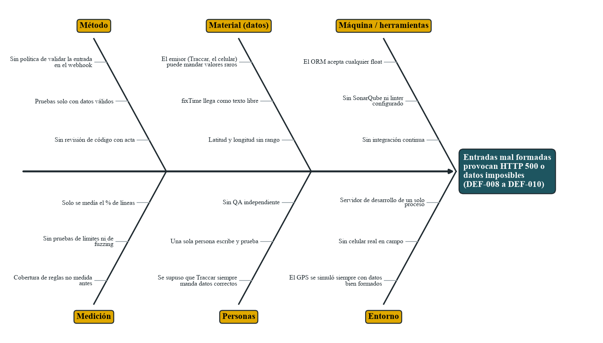
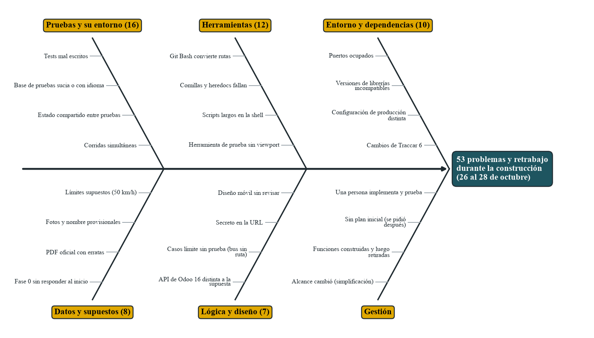

# Diagramas de Ishikawa (causa y efecto)

Dos diagramas, uno por cada efecto que importa al proyecto. Las causas salen de la evidencia (bitácora, pruebas y código), no de la imaginación: cada una indica dónde se vio. Las figuras las dibuja `qa/generar_docs.py` desde `qa/datos_calidad.py`.

## 1. Efecto: entradas mal formadas provocan HTTP 500 o datos imposibles

Es el hallazgo de la evaluación de calidad: DEF-008, DEF-009 y DEF-010 (ver `05-registro-de-defectos.md`). El 100 % de los fallos de la suite en vivo y de la auditoría salió de aquí.

| Rama | Causa | Evidencia | Acción | Estado |
|---|---|---|---|---|
| Método | Sin regla de validar la entrada del webhook | `_apply_position` solo comprueba que haya hora, latitud y longitud | Regla 2 de la política (`01-politica-y-alcance.md`) y validar la posición | Pendiente |
| Método | Pruebas solo con datos válidos | `qa/` tuvo que agregar E7, E8, E9; `tests/` no tenía ninguna | Portar E7, E8 y E9 a la suite de Odoo | Pendiente |
| Método | Sin revisión de código con acta | La bitácora no registra revisiones por pares | Checklist de revisión antes de fusionar a `develop` | Pendiente |
| Material (datos) | El emisor puede mandar valores raros | Auditoría: 18 latitudes y 14 longitudes imposibles, todas guardadas | Validar rango y tipo | Pendiente |
| Material (datos) | La hora llega como texto libre | `parse_traccar_dt` usa `isoparse` sin capturar el error (E9) | Capturar y responder 400 | Pendiente |
| Material (datos) | Latitud y longitud sin rango en el modelo | `bus.position` usa `Float` sin restricción | `@api.constrains` de rango | Pendiente |
| Máquina / herramientas | El ORM acepta cualquier valor numérico | Se guardó la latitud 95° | Restricción en el modelo | Pendiente |
| Máquina / herramientas | Sin análisis estático | No hay `.flake8`, `.pylintrc` ni SonarQube | `chore/lint-config` y SonarQube | Pendiente |
| Máquina / herramientas | Sin integración continua | Las pruebas se ejecutan a mano | Pipeline con pruebas, cobertura y análisis | Pendiente |
| Medición | La cobertura de reglas no se medía | 15 de 17 reglas con prueba; faltan R16 y el celular real | Medirla en cada entrega (`04-resultados-y-metricas.md`) | Hecho hoy |
| Medición | Sin pruebas de límites ni de entradas aleatorias | La auditoría aleatoria es nueva | `qa/auditoria.py` en cada entrega | Hecho hoy |
| Medición | Solo se medía el % de líneas | Primera medición de cobertura con ramas | coverage.py con `--branch` | Hecho hoy |
| Personas | Se supuso que Traccar siempre manda datos correctos | Bitácora: se probó con GPS simulado bien formado | Tratar toda entrada externa como no confiable | Pendiente |
| Personas | Una sola persona escribe y prueba | RACI previo inexistente | Rol de QA independiente (propuesta de RACI) | Propuesto |
| Entorno | El GPS siempre fue simulado | Fase 9 sin celular real | Turno completo con celular y Traccar reales | Pendiente |
| Entorno | Servidor de pruebas de un solo proceso | P2 con CV de 143 % | Repetir con varios procesos | Pendiente |

### Los cinco porqués del fallo más repetido

1. ¿Por qué hubo respuestas 500 en el webhook? Porque `parse_traccar_dt` y el ORM lanzan una excepción ante una hora o una latitud inválidas.
2. ¿Por qué no se captura? Porque se supuso que quien envía siempre manda datos correctos.
3. ¿Por qué se supuso? Porque todas las pruebas y el GPS simulado enviaban posiciones bien formadas.
4. ¿Por qué solo se probaba el camino feliz? Porque la misma persona escribía el código y sus pruebas y se concentró en la seguridad del webhook (secreto) y no en su contenido.
5. ¿Por qué nadie lo advirtió? Porque no existía una regla de validar la entrada, ni un QA independiente, ni pruebas de entradas aleatorias.

**Causa raíz:** falta de una política de validación de la entrada y de una verificación independiente. Ambas se corrigen con las reglas 2 y 5 de la política y con el rol de QA.

## 2. Efecto: 53 problemas y retrabajo durante la construcción

Los 53 problemas de la bitácora (ver `07-pareto.md`, sección 3). Los números entre paréntesis son los de cada categoría.

| Rama | Causas | Qué se hizo | Qué falta |
|---|---|---|---|
| Pruebas y su entorno (16) | Tests mal escritos, base de pruebas sucia o con el idioma cargado, estado compartido entre pruebas, dos corridas simultáneas | Base nueva en cada corrida (`ejecutar_todo.sh`), buses separados por prueba, reinicio del servidor antes de medir los límites | Integración continua que cree la base cada vez |
| Herramientas (12) | Git Bash convierte rutas, comillas y heredocs fallan, scripts largos en la shell, herramienta de prueba sin viewport | `MSYS_NO_PATHCONV=1`, scripts escritos como archivos | Ejecutar todo dentro de contenedores y no desde Git Bash |
| Entorno y dependencias (10) | Puertos ocupados, versiones incompatibles, configuración de producción distinta, cambios de Traccar 6 | `ODOO_PORT`, versiones fijadas en el `Dockerfile`, `data_dir` fijo | Probar en un Linux real y fijar la versión de Traccar |
| Datos y supuestos (8) | Fase 0 sin responder al inicio, PDF oficial con erratas, fotos y nombre provisionales, límites supuestos | Fase 0 respondida, supuestos anotados en la bitácora | Confirmar con la UTA (país, kichwa, coordenadas, límites) |
| Lógica y diseño (7) | API de Odoo 16 distinta a la supuesta, casos límite sin prueba, secreto en la URL, diseño móvil sin revisar | Pruebas por cada caso, cabecera para el secreto, revisión a 390 px | Más pruebas de casos límite |
| Gestión | El alcance cambió, se construyeron funciones que luego se retiraron, el plan se pidió después, una persona implementa y prueba | Plan por fases, simplificación documentada | Plan de implementación antes de construir y QA independiente |

Lectura: la rama de **pruebas y su entorno** pesa más que la de lógica del código. La mayor parte del retrabajo vino de cómo se preparaba la prueba, no del producto.
