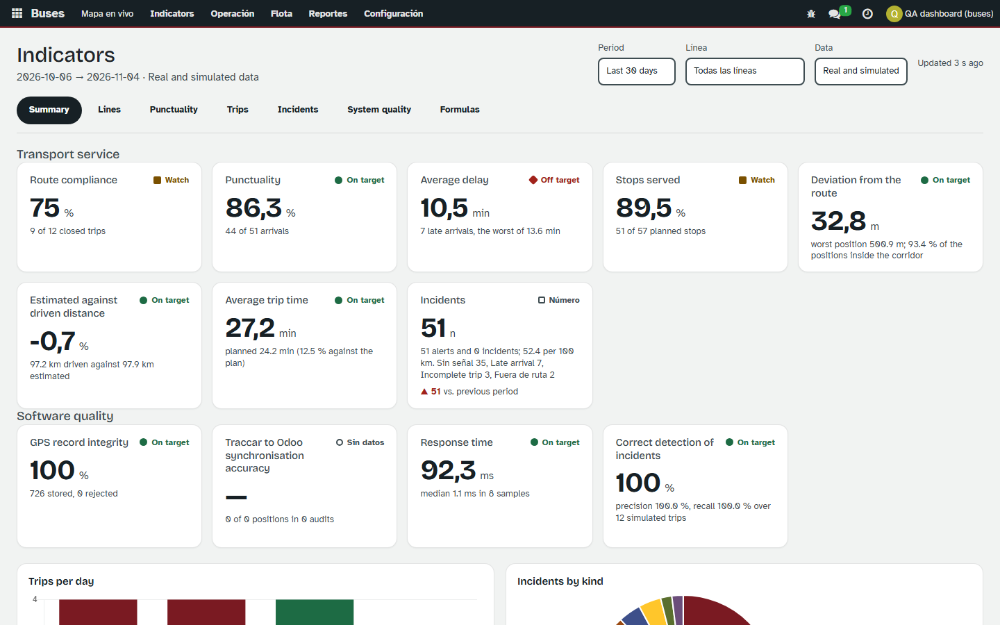
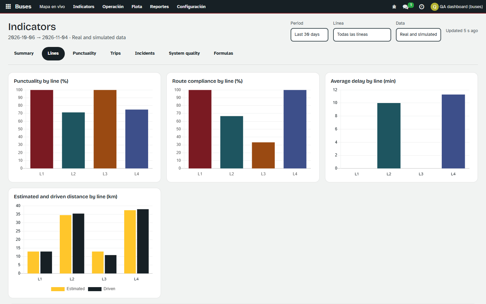
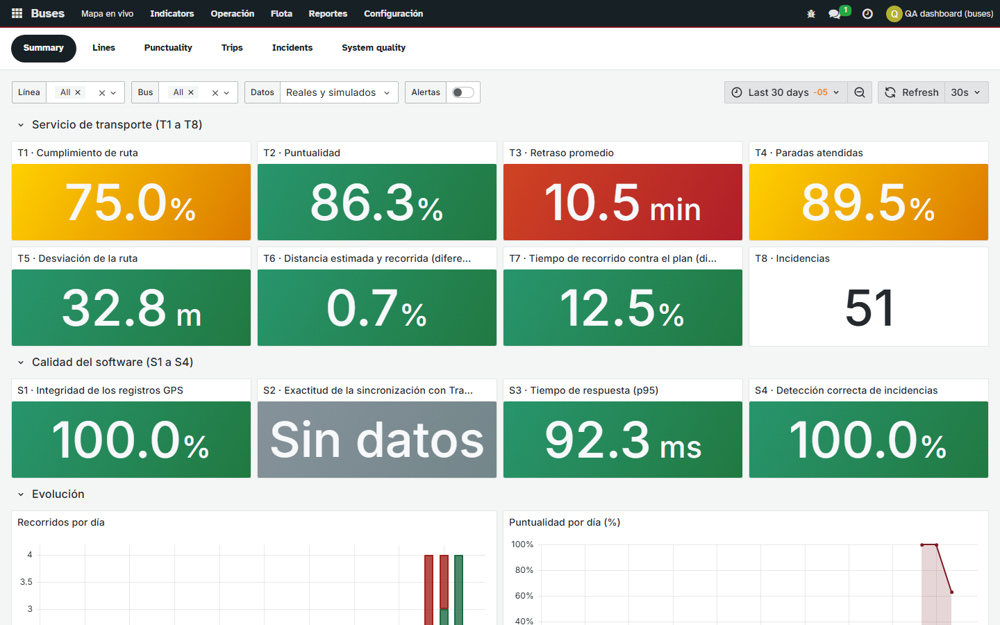
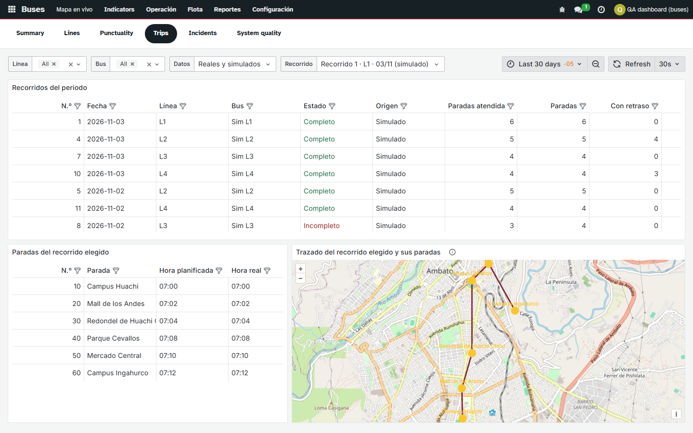
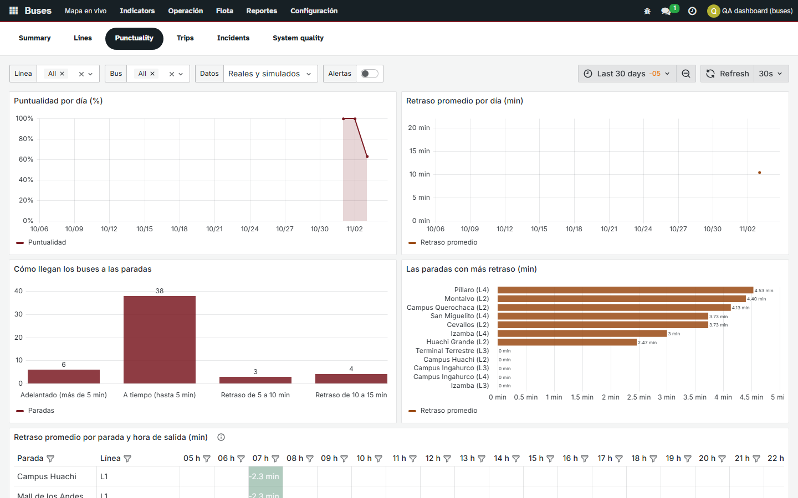
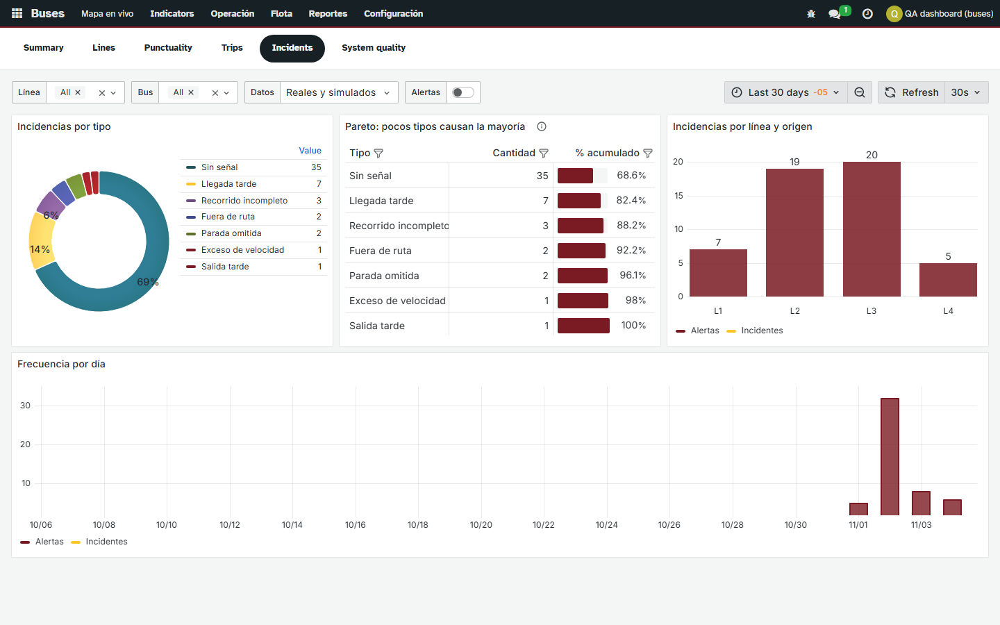

# Tablero: Odoo y Grafana

Evidencia de la Actividad 8 del proyecto final (criterio 6, métricas y tablero). El PDF pide un tablero que muestre las métricas del proyecto y nombra dos alternativas: el tablero hecho dentro de Odoo
(alternativa A) y Power BI (alternativa B). El proyecto entrega **la alternativa A completa** y, como complemento, **Grafana incrustado en Odoo**, que ocupa el lugar de Power BI porque es gratuito,
liviano y sus tableros son código versionado. Cómo se instala y opera: `docs/guias/GRAFANA.md`. Fórmulas y consultas de cada indicador: `docs/calidad/14-metricas-de-transporte.md`.

> Antes de la defensa conviene confirmar con el docente que una herramienta distinta de Power BI, accesible desde Odoo, también vale. Si no valiera, el tablero de Odoo cubre el criterio por sí solo.

## 1. Los dos tableros

| | Tablero de Odoo (alternativa A) | Grafana incrustado (complemento) |
|---|---|---|
| Dónde | Buses › Indicators › Odoo dashboard | Buses › Indicators › Grafana |
| Qué lo hace | Pantalla OWL del módulo + gráficos de Chart.js | Seis tableros JSON aprovisionados + vistas SQL |
| Indicadores | Los 12 (T1 a T8, S1 a S4) con fórmula, fuente, consulta SQL y estado | Los mismos 12, con las mismas fórmulas y umbrales |
| Filtros | Periodo (7, 30, 90 días o fechas), línea, datos reales/simulados | Periodo (cualquiera), línea, bus, reales/simulados, recorrido |
| Actualización | Cada 30 s | Cada 30 s |
| Particularidad | Muestra la fórmula y el SQL de cada indicador; botones para medir el rendimiento y auditar la sincronización | Mapa del trazado del recorrido, mapa de calor de retrasos, alertas como anotaciones |

Los dos leen los mismos registros y dan las mismas cifras: lo comprueban las pruebas (sección 4).

## 2. Tablero de Odoo (siete pestañas)

| Pestaña | Qué responde | Gráficos y tablas |
|---|---|---|
| Summary | ¿Cómo va el servicio y cómo va el software? | 12 tarjetas con valor, estado (palabra y forma, no solo color) y cambio contra el periodo anterior; recorridos por día; incidencias por tipo |
| Lines | ¿Qué línea va mejor o peor? | Puntualidad, cumplimiento, retraso y distancia por línea; tabla comparativa |
| Punctuality | ¿Cuándo y dónde se retrasan? | Puntualidad por día, distribución de retrasos, paradas con más retraso |
| Trips | ¿Qué pasó en cada recorrido? | Tabla de los últimos recorridos con paradas, retraso, distancias y lo que detectaron las reglas; abre el recorrido |
| Incidents | ¿Qué falla y cuánto? | Pareto, frecuencia por día y por línea |
| System quality | ¿Funciona bien el sistema? | S1 a S4, tiempo de respuesta en el tiempo, botones de medición y auditoría |
| Formulas | ¿De dónde sale cada cifra? | Los 12 indicadores con fórmula, fuente, unidad, umbrales, interpretación y la consulta SQL |

Capturas (`docs/calidad/evidencias/tablero-odoo/`, hechas con Playwright sobre datos de los 12 recorridos simulados):

| Resumen | Líneas |
|---|---|
|  |  |

Las otras pestañas: `3-puntualidad`, `4-recorridos`, `5-incidencias`, `6-calidad` y `7-formulas` en la misma carpeta; la vista de teléfono es `1-resumen-movil.png`.

## 3. Grafana (seis tableros)

| Tablero | Paneles |
|---|---|
| Resumen | 12 indicadores con umbrales verde, ámbar y rojo; tabla «este periodo contra el anterior»; recorridos y puntualidad por día |
| Rutas | Puntualidad, cumplimiento, retraso, distancia estimada y recorrida y alertas por línea; tabla comparativa |
| Puntualidad | Puntualidad y retraso por día; cómo llegan los buses (distribución); paradas con más retraso; **mapa de calor** de retraso por parada y hora de salida |
| Recorridos | Tabla de recorridos; paradas del recorrido elegido con hora planificada, real y retraso; **mapa** con el trazado GPS y las paradas |
| Incidencias | Anillo por tipo; **Pareto** con porcentaje acumulado; incidencias por línea y origen; frecuencia por día |
| Calidad del sistema | S1 a S4; posiciones guardadas y rechazadas; tiempo de respuesta (mediana y p95); auditoría de sincronización; detección correcta en los simulados |

Capturas dentro de Odoo (`docs/calidad/evidencias/grafana/`):

| Resumen | Recorridos (con el mapa) |
|---|---|
|  |  |

| Puntualidad | Incidencias |
|---|---|
|  |  |

Rutas, Calidad del sistema y las vistas de teléfono están en la misma carpeta (`2-rutas`, `6-calidad`, `1-resumen-movil`, `4-recorridos-movil`).

Las anotaciones de alertas (cada alerta de las reglas sobre las series de tiempo) están disponibles con el interruptor «Alertas» de cada tablero; arrancan apagadas para no saturar las gráficas.

## 4. Pruebas que lo respaldan

| Qué se comprueba | Prueba |
|---|---|
| Las vistas `kpi_*` existen, se leen, no llevan datos personales y se reconstruyen al actualizar el módulo | `TestKpiViews` (9) |
| El rol `grafana_reader` lee las vistas, **no** lee `bus_trip`, `bus_position`, `res_users`, `res_partner`, `bus_incident` ni `ir_config_parameter`, no escribe, y es de solo lectura con límite de tiempo y conexiones | `TestGrafanaRole` (5) |
| El token: firma válida, rol siempre Viewer aunque el usuario sea gestor, sin nombre ni correo, vence a la hora fijada, no vale con otro secreto, el secreto no viaja, lo reciben solo los usuarios de buses (no los choferes del portal) | `TestGrafanaAccess` (14) y `TestGrafanaRoute` (3) |
| Ajustes: dirección web válida, secreto de 16 caracteres como mínimo, duración de 5 a 1440 minutos; el menú tiene los dos tableros | `TestGrafanaSettings` (4) |
| Los seis JSON: uids, refresco de 30 s, no editables, filtros de línea, bus y datos, umbrales de los indicadores, nombre de cada tipo de alerta, aprovisionamiento | `TestDashboardFiles` (9) |
| **Cada consulta de cada panel se ejecuta** contra datos reales de prueba y solo lee vistas `kpi_*`; los filtros acotan; el Pareto suma 100; el mapa recibe el trazado y las paradas | `TestDashboardQueries` (8) |
| **Los paneles dan las mismas cifras que los indicadores de Odoo** (T1 a T8, S1 a S4) sobre los mismos datos | `TestSameFiguresAsTheIndicators` (3) |
| Con Grafana en marcha: salud, fuente de datos, seis tableros, sin acceso anónimo, token válido/falso/vencido/de otro emisor, rol Viewer, sin Explore ni registro, y que **un lector que escribe SQL a mano no puede leer las tablas de Odoo** | `qa/grafana_smoke.py` (19 comprobaciones) |

Resultado de la corrida completa del módulo: 480 pruebas, 0 fallos (2026-11-04).

## 5. Hallazgos y decisiones

1. **El token dura una jornada, no 5 minutos.** Con el inicio de sesión por JWT, Grafana no abre una sesión: el navegador manda el token en cada consulta. Con 5 minutos, el tablero se quedaría sin datos al
   rato. La pantalla de Odoo renueva el token antes de que venza; se puede acortar en Ajustes. La protección real es el rol: Viewer y vistas sin datos personales.
2. **Un Viewer de Grafana puede escribir SQL a mano** (así funciona Grafana). Por eso el límite no está en Grafana sino en la base: la prueba de humo lo confirma pidiendo `res_users`, `bus_position` e
   `ir_config_parameter` y recibiendo «permission denied».
3. **Un Viewer ve la lista de fuentes de datos** (nombre, servidor `db:5432`, usuario `grafana_reader`, sin contraseña). No puede crear ni cambiar ninguna (403).
4. **Plugins de Grafana innecesarios** (Explore, Pyroscope…) se desactivan: producían errores en la consola del navegador del iframe.
5. **El mapa base** de Grafana por defecto (CARTO) exige una clave de API; el mapa del recorrido usa OpenStreetMap.
6. **Lo que no se hizo**: reglas de alerta de Grafana (opcional), minigráficos en las tarjetas y Pareto con línea acumulada (límites de Grafana). Ver `docs/guias/GRAFANA.md`, sección 6.
