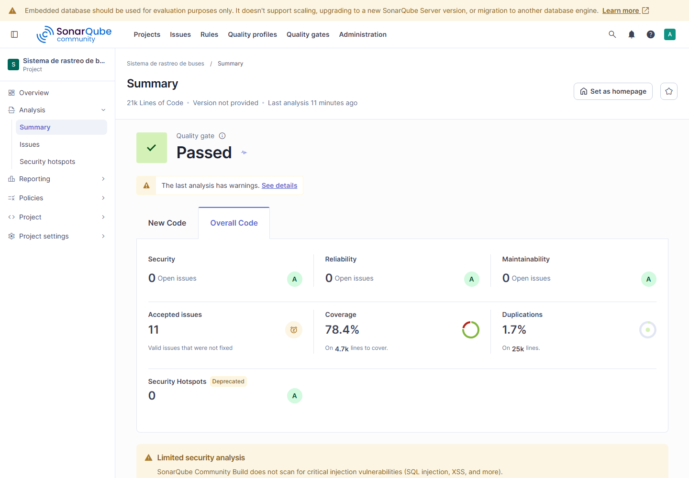

# Análisis estático con SonarQube

Evidencia de la Actividad 9 del proyecto final (criterio 8, calidad del software con ISO/IEC 25010 y SonarQube). Se analizó **todo el proyecto**: el módulo de Odoo (Python, JavaScript, XML), la app del chofer
(TypeScript) y los scripts de calidad y despliegue. Fecha: 2026-11-05. SonarQube Community Build **26.10.0.133078**, escáner `sonar-scanner-cli`.

## 1. Resultado

| | Primer análisis | Después de corregir |
|---|---|---|
| **Quality Gate** (Sonar way) | Aprobado | **Aprobado** |
| Bugs | **16** (calificación de fiabilidad C) | **0** (A) |
| Vulnerabilidades | **12** (calificación de seguridad D) | **0** (A) |
| Puntos de acceso de seguridad (*hotspots*) | 0 | 0 |
| Código con mal olor (*code smells*) | 11 | **0** |
| Deuda técnica | 107 min | **0** (A) |
| Duplicaciones | 1,7 % | 1,7 % |
| Cobertura | 20,4 % (ver 4.1) | **78,4 %** (líneas 75,9 %, ramas 87,1 %) |
| Hallazgos abiertos | 39 | **0** (27 corregidos, 11 aceptados con justificación, 1 falso positivo) |
| Líneas de código | 20 754 | 20 760 |

Capturas (`docs/calidad/evidencias/sonarqube/`): 

Las demás: `2-quality-gate.png`, `3-hallazgos.png`, `4-cobertura-por-archivo.png`, `5-seguridad.png`, `6-mantenibilidad.png`. El reporte exportado (JSON de SonarQube): `antes-hallazgos.json`, `antes-metricas.json`,
`despues-metricas.json`, `despues-quality-gate.json` y `despues-hallazgos-aceptados.json` (con el comentario de cada hallazgo aceptado).

## 2. Cómo se ejecuta

| Archivo | Para qué |
|---|---|
| `sonar-project.properties` | Qué se analiza (`addons/bus_tracking`, la app, `qa`, `scripts`, `docker`, `proxy`), qué es código de prueba y qué se excluye (`node_modules`, traducciones, librerías, evidencias). |
| `docker-compose.sonar.yml` | SonarQube Community con la versión fijada, **solo para desarrollo** (base de datos embebida, nunca en producción). |
| `scripts/sonar-coverage.sh` | Corre las 512 pruebas de Odoo bajo `coverage.py` (`coverage.xml`) y las 167 de Jest (`lcov.info`). |
| `scripts/sonar-scan.sh` | Cobertura y `sonar-scanner` en un contenedor. |

```bash
docker compose -f docker-compose.sonar.yml up -d              # http://localhost:9000 (admin/admin: cámbiala al entrar)
# crear el proyecto «sistema-rastreo-buses» y un token de análisis (Mi cuenta › Seguridad)
SONAR_TOKEN=<token> scripts/sonar-scan.sh
curl -u "$SONAR_TOKEN:" "http://localhost:9000/api/qualitygates/project_status?projectKey=sistema-rastreo-buses"
```

El análisis completo tarda unos 15 minutos en Windows con Docker Desktop (4 de pruebas con cobertura y 10 del escáner, lentos por el montaje del disco); en Linux es bastante menos.

## 3. Clasificación de los 39 hallazgos y qué se hizo

| Regla | Qué dice | Tipo | Gravedad | Cant. | Decisión |
|---|---|---|---|---|---|
| `S9383` (TS y JS) | Una promesa no se espera ni lleva `.catch`: si falla, el error se pierde | Bug | Mayor | 13 | **Corregido**: las llamadas sueltas (vibración, sondeo cada 12 s, refresco de mapas y tablero) terminan en `.catch`; el cierre de sesión y el idioma guardado tienen su alternativa |
| `S4822` | `try` que no sirve porque la promesa ya lleva `.catch` | Bug | Mayor | 1 | **Corregido** (se quitó el `try`) |
| `S1764` | `lat != lat` (comparar un número consigo mismo) para detectar NaN | Bug | Mayor | 2 | **Corregido**: la comparación de rango ya es falsa para NaN; se quitó la redundante |
| `S4790` | Hash SHA-1 | Vulnerabilidad | **Crítica** | 1 | **Corregido**: SHA-256 (solo sirve de clave de caché de las líneas del mapa, sin valor criptográfico) |
| `S6890` | Uso de `pytz` con Python 3.9 | Mal olor | **Crítica** | 1 | **Corregido**: la función `local_now` no se usaba en ningún lugar; se eliminó |
| `S8786` | Expresión regular de rendimiento supralineal | Mal olor | Mayor | 3 | **Corregido**: cuantificadores acotados (`\d{1,9}`) y un bucle en lugar de `/\/+$/` |
| `S7773` | `Number.parseInt`/`isNaN`/`NaN` en lugar de los globales | Mal olor | Menor | 6 | **Corregido** |
| `S2068` | «Contraseña» escrita en el código | Vulnerabilidad | Mayor | 8 | **7 aceptados, 1 falso positivo** (ver 4.3) |
| `S5332` | Protocolo `http` | Vulnerabilidad | Menor | 3 | **Aceptados** (ver 4.3) |
| `S1313` | Dirección IP escrita en el código | Mal olor | Menor | 1 | **Aceptado** (ver 4.3) |

Antes y después por tipo: bugs 16 → 0, vulnerabilidades 12 → 0 (1 corregida, 11 aceptadas o falso positivo), malos olores 11 → 0 (10 corregidos, 1 aceptado).

## 4. Interpretación

### 4.1 Cobertura

Con 512 pruebas de Odoo y 167 de Jest, la cobertura de **líneas del código nuevo y existente es 78,4 %** y la de ramas 87,1 %. Por área:

| Área | Cobertura | Lectura |
|---|---|---|
| Modelos de Odoo (`models/`) | 95,1 % | Donde está la lógica de negocio: casi todo se ejecuta en alguna prueba |
| Controladores de Odoo | 93,8 % | Idem |
| App del chofer: `diagnostics`, `config`, `shift`, `api`, `incidents`, `state` | 73 a 95 % | Lógica pura con pruebas de Jest |
| App del chofer: `gps`, `ui`, `map` | 26 a 53 % | Pantallas y mapa: se verifican con las pruebas de interfaz de `qa/` (Playwright), que SonarQube no mide |
| JavaScript del módulo de Odoo (`static/src`) | **0 %** | Las pantallas del tablero y del mapa se prueban en el navegador (capturas y comprobaciones con Playwright), no con pruebas unitarias |

El primer análisis dio 20,4 % porque el informe de cobertura de Python tenía mal las rutas de los archivos y SonarQube lo ignoró; se corrigió en `scripts/sonar-coverage.sh` (reescribe `mnt/extra-addons/` a `addons/`).
**Límite reconocido**: el JavaScript del módulo no tiene pruebas unitarias; es el siguiente punto a cubrir (ver `docs/arquitectura/PLAN-RUBRICA.md`, R11).

### 4.2 El Quality Gate

«Sonar way» exige sobre el **código nuevo**: ningún hallazgo nuevo, cobertura de al menos 80 %, duplicaciones de hasta 3 % y todos los hotspots revisados. Resultado: **aprobado**.
La cobertura del código nuevo (42,9 %) no alcanza el 80 %, pero SonarQube solo aplica esa condición cuando hay **20 o más líneas nuevas por cubrir** y aquí hay 19; con más líneas, esa condición habría fallado.
Por eso no se usa el aprobado como único argumento: la cobertura global y la de cada área (4.1) son las cifras que se defienden.

### 4.3 Los hallazgos aceptados (11 + 1 falso positivo)

Cada uno quedó en SonarQube como «aceptado» con su comentario (están en `despues-hallazgos-aceptados.json`):

- **7 × `S2068`, contraseñas en `qa/qa_suite.py` y `scripts/dev_seed.py`**: no son secretos. La suite de QA crea usuarios desechables en una base de datos que se borra al terminar, y `dev_seed.py` crea choferes de ejemplo en una base local
  (producción la crea `scripts/init-prod.sh` con claves aleatorias y nunca ejecuta el seed).
- **1 × `S2068` falso positivo**: `password: 'Contraseña'` es la etiqueta del campo en la pantalla de acceso de la app.
- **3 × `S5332`, http en `qa/mock_driver_api.py`**: es un servidor simulado local para probar la interfaz; la app rechaza `http` fuera de `localhost` (`src/config/odooUrl.ts`).
- **1 × `S1313`, `10.255.255.255`**: dirección no enrutable que solo sirve para preguntarle al sistema qué interfaz local usaría; no se envía nada.

### 4.4 Lo que SonarQube Community no ve

La edición gratuita **no analiza vulnerabilidades de inyección (SQL, XSS)** ni dependencias (sin análisis de composición de software). Eso se cubre con otras pruebas del proyecto: las consultas SQL de los indicadores usan parámetros (`bus.kpi`), hay pruebas de que el texto que escribe una persona se escapa
(`test_portal.py`, `test_complaints.py`), pruebas de acceso y de la API (`test_http.py`, `test_driver_auth.py`), la auditoría estática de `qa/auditoria.py` y `gitleaks` en el CI para secretos.
Las dependencias no tienen aún un análisis automático (por ejemplo `npm audit`): es una limitación a decir en la defensa.

El aviso «Missing blame information» del análisis aparece porque se analizó con archivos aún sin confirmar en git; desaparece al confirmar.

## 5. Relación con ISO/IEC 25010

| Característica | Lo que aporta este análisis |
|---|---|
| Fiabilidad | 16 bugs corregidos (promesas sin manejar que podían perder errores de red o del almacenamiento) |
| Seguridad | Una función criptográfica débil reemplazada; ninguna credencial real en el código; hallazgos de prueba justificados |
| Mantenibilidad | Deuda técnica de 107 a 0 min; 1,7 % de duplicación; calificación A |
| Adecuación funcional | Las 512 + 167 pruebas pasan antes y después de las correcciones |

## 6. Pendiente opcional

Integrar el análisis al CI con un `SONAR_TOKEN` (necesita un SonarQube accesible desde GitHub Actions: SonarCloud o un servidor propio; no se hizo porque el servidor de este proyecto es solo de desarrollo).
